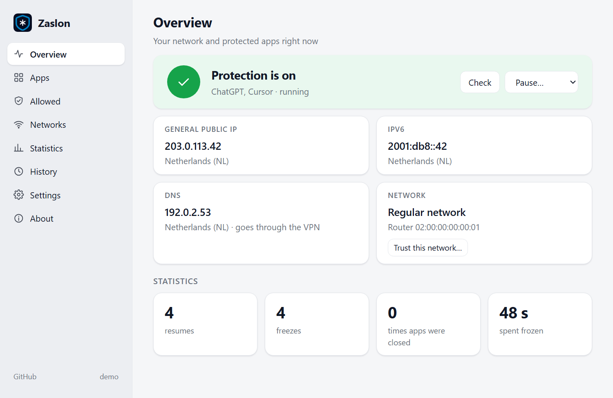
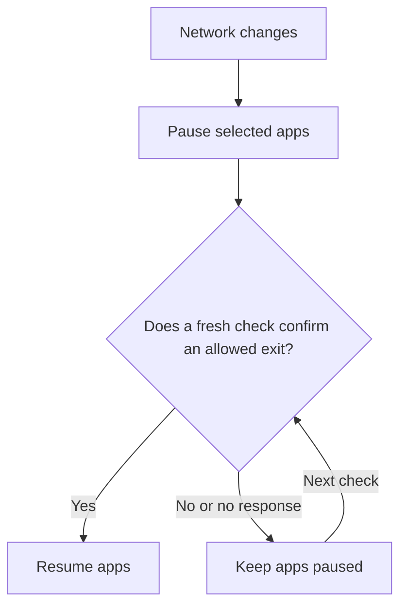

# Zaslon

If your VPN drops and a check finds a public IP outside your allowed list, Zaslon pauses the apps you choose. They resume once a fresh check confirms an allowed IP. You can protect ChatGPT and Cursor, for example, and keep using your browser as usual.

[Русский](README.md) · [Download Zaslon](https://github.com/avazar/zaslon/releases)



## How it works

Choose which apps to protect and which IP addresses, subnets or countries they may use. When the network changes, Zaslon pauses those apps and any child processes it has detected. It then checks the connection again.



This is the default, strict behaviour. While the network is stable, Zaslon checks the IP in the background. If an app uses a separate VPN route, you can enable checks against its service domains. These run only while that app is running. If a domain times out, Zaslon retries just that domain immediately.

## Getting started

### Install on Windows

Extract the Windows ZIP from the [releases page](https://github.com/avazar/zaslon/releases) and run `zaslon.exe`. To install with a Start menu shortcut, use the PowerShell installer.

```powershell
irm https://raw.githubusercontent.com/avazar/zaslon/dev/install.ps1 | iex
```

### Install on Linux or macOS

Run this in a terminal as your usual user, without `sudo`.

```sh
curl -fsSL https://raw.githubusercontent.com/avazar/zaslon/dev/install.sh | sh
```

### Settings

1. Connect to the VPN you want to use. Under **Allowed**, add a known exit IP, subnet or country. If your VPN has a fixed IP, allowing that one address is more precise than allowing a whole country.
2. Under **Apps**, turn on protection for the programs you choose. A new profile starts with no apps selected. You can give each app its own permissions.
3. Open one of those apps and look at **Overview**. It shows the check result and which apps are running or paused. You can close the panel and leave protection running.

## Uninstall

If you extracted the Windows ZIP manually, turn off **Start at login** in Settings, choose **Quit (turns protection off)** from the Zaslon tray menu, then delete the program files you extracted.

If you used the installer, quit Zaslon from its tray or menu bar icon and run the command for your system. The installer keeps your settings and backups.

**Windows (PowerShell)**

```powershell
& ([scriptblock]::Create((irm https://raw.githubusercontent.com/avazar/zaslon/dev/install.ps1))) -Uninstall
```

**Linux and macOS (terminal)**

```sh
curl -fsSL https://raw.githubusercontent.com/avazar/zaslon/dev/install.sh | sh -s -- uninstall
```

## What to know

- **Pausing an app has limits.** Zaslon suspends processes. Packets the app has already handed to the operating system can still leave the device. Blocking traffic at the network level requires firewall rules or a VPN kill switch.
- **Checks measure Zaslon’s own connection.** An app with its own proxy can use a different IP, even for the same domain. A matching country alone cannot prove the VPN is working.
- **An unavailable check can pause an app.** By default, Zaslon waits for confirmation. You can choose to continue with a warning when a check is unavailable. A disallowed IP still triggers a pause. During a long pause, a request inside the app may time out.
- **Zaslon is a preview release.** VPN disconnect and reconnect scenarios have been tested on Windows. Real network failures and desktop sessions on Linux and macOS still need testing.

No account is required. Your settings and history stay on your computer. External check services see the IP that Zaslon connects from.

[Network checks](docs/NETWORK-CHECKS.md) · [Windows guide](docs/WINDOWS-PACKAGE.txt) · [Linux and macOS guide](docs/UNIX-PACKAGE.txt) (guides in Russian) · [Report a problem](https://github.com/avazar/zaslon/issues)

Zaslon is based on [Kordon v1.2.1](https://github.com/ef1m03/kordon/tree/v1.2.1) and is distributed under the [MIT License](LICENSE).
