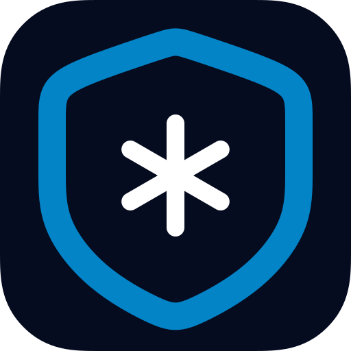

> Based on [Kordon](https://github.com/ef1m03/kordon), version [v1.2.1](https://github.com/ef1m03/kordon/tree/v1.2.1), published under MIT. Zaslon is developed as an independent project.

<p align="center">
  
</p>

<h1 align="center">Zaslon</h1>

<p align="center">Suspend selected apps on network changes and disallowed public IP addresses.</p>

<p align="center">
  <a href="README.md">Русский</a> ·
  <a href="#windows-installation">Windows</a> ·
  <a href="#linux-and-macos-installation">Linux/macOS</a> ·
  <a href="#build-from-source">Build</a> ·
  <a href="#recovery-after-a-crash">Recovery</a> ·
  <a href="docs/NETWORK-CHECKS.md">Network checks (Russian)</a> ·
  <a href="LICENSE">MIT</a>
</p>

Zaslon checks the public IP against configured rules and suspends selected apps
along with their detected descendants. On a relevant or unknown network event, it suspends
processes before starting a fresh check. Automatic resumption requires a
successful, current check by default. Explicit failure policies can permit
continued operation with a warning when a measurement is unavailable.

**Zaslon is not a VPN, proxy, or packet filter.** It does not redirect traffic or
change firewall rules, DHCP, DNS, routes, or adapter settings. Process suspension
cannot guarantee that no packets bypass a VPN: an app may transmit before an
event is handled, and data already handed to the OS may still be sent. Enforcing
traffic restrictions at the network layer requires a separate, tested filter.

## Project status

The first prerelease, [Zaslon 1.3.0](https://github.com/avazar/zaslon/releases/tag/v1.3.0),
includes installers for Windows, Linux, and macOS. It is intended for testing;
readiness for daily use has not been established. Development takes place on
`dev`, and self-update remains disabled.

| Platform | Validated stages |
|---|---|
| Windows | Native tests, `go vet`, builds, and ready-EXE checks in CI. Suspension of a test app and its child, protection recovery after a crash, and emergency resumption. IPv4 VPN loss and reconnection also tested in a Windows 11 VM. |
| Linux | GitHub Actions passed native tests, `go vet`, the race detector, app and recovery-helper builds, and the version command. Tests exercised suspension of a test process and recovery after a crash; installation, update, and removal were checked in an isolated HOME without starting protection. Native execution used AMD64. |
| macOS | GitHub Actions on Intel passed native tests, `go vet`, the race detector, universal GUI bundle and recovery-helper builds, and the version command. Tests exercised suspension of a test process and recovery after a crash; installation, update, removal, and the copied app's signature were checked in an isolated HOME without starting protection. Native Apple Silicon execution is still unverified. |

[CI on all three OSes](https://github.com/avazar/zaslon/actions/workflows/ci.yml)
checks tests, builds, and package contents. It does not validate GUI interaction
in a user session or recovery using the packaged Unix binaries.
DNS/IPv6 during actual VPN loss, sleep/wake, WSL, and power loss require
separate testing. Windows network tests used dedicated test processes;
see [coverage and limitations (Russian)](docs/NETWORK-CHECKS.md#проверки).

## How protection works

1. Zaslon subscribes to system notifications about IPv4/IPv6 interface, address,
   and route changes. It also checks processes and interface state every 500 ms.
2. A relevant or unknown network event invalidates the previous check and suspends selected processes.
   Route changes count even when adapter addresses stay the same.
3. A fresh public IP check is evaluated against shared or per-app rules. A stale
   response cannot automatically resume processes after a network change.
4. A successful result releases Zaslon's own suspension. A disallowed IP, failed
   required check, or network subscription error keeps apps suspended without a
   deadline. Apps are never terminated automatically.
   Unavailable results may be explicitly ignored in settings; this exception
   does not override a received disallowed IP or a subscription error.

On Windows, local IPv6 notifications from a confirmed Teredo interface without
an external address or route can be filtered without suspension. Unknown events
and changes to VPNs, ordinary adapters or external routes still suspend first.
See [network diagnostics](docs/NETWORK-CHECKS.md#отбор-сетевых-уведомлений-windows).

Without relevant network events, the public IP is checked every 5 seconds by default.
These periodic checks do not suspend running apps in advance: suspension follows
an unsuccessful result.

A suspended window may become unresponsive. Long pauses can cause timeouts,
broken connections, and requests that need to be retried; preservation of unsaved
work is not guaranteed. Manually pausing protection or quitting Zaslon normally
releases its confirmed suspensions, allowing apps to use the current network again.

## Apps, descendants, and updates

Presets cover Claude, ChatGPT, Codex, Cursor, and other programs. Custom rules can
match executable names and path substrings. Detected descendants of a matching
process are included regardless of their names. New processes are found by
polling, rather than intercepted before they start running.

Matching a name or stable path component avoids tying a rule to one version's
installation folder, so a rule can survive updates. Changes to names, installation
methods, or process structure need separate verification. Broad rules can also
match unrelated programs.

On Windows, Zaslon reads command lines for Node, Bun, Python/Python3 and Deno
to support custom `args:` rules. The Claude and Codex presets also recognise
Node/Bun launches by the entry script path:
`@anthropic-ai/claude-code/cli.js` and `@openai/codex/bin/codex.js`.
Direct launches and `bun run`, spaces, Unicode and both path separators are supported.
Version directories may change as long as this path within the package stays the same.
A package mentioned in a prompt, `--eval` or another script's arguments does not
activate a built-in rule. Native `claude.exe`/`codex.exe` are matched by name.

Unknown launch-option forms, `package.json` aliases and command lines hidden by the
OS can prevent recognition; Zaslon does not automatically target every Node/Bun process.
Check that the intended process appears in the panel; custom rules are available
for unusual launches. `args:` still searches the entire command line for a substring,
so choose a sufficiently specific marker. Full command lines are not stored in the
recovery journal. Descendants of a recognised process are included through the process
tree. Protection of services, WSL, containers, and processes created
through a separate broker has not been validated. Elevated processes may require
matching privileges to suspend. If the OS refuses suspension, the process may
keep running; the error is displayed in the UI.

## Network check rules

- **IPs, subnets, and countries.** A match with an allowed IP/subnet or country is
  sufficient. Allowing a country is broader than allowing a VPN address and does
  not prove tunnel use. An empty list permits no exit; the current IP is not added
  automatically. `app_rules` replaces the shared allow-list for a particular app.
- **IP confirmation.** Two matching IP-service responses are required by default.
  The check waits for all requests within a shared timeout (4 seconds), even after
  two responses agree. Any received disagreement keeps apps suspended. Unavailable
  services do not vote; responses beyond the timeout are unknown. A cancelled
  check does not return partial success.
- **IPv6.** Checked separately and enabled by default. A disallowed public IPv6
  keeps apps suspended. If the public check fails while an active interface has an
  IPv6 address other than loopback or link-local, the result is uncertain. This
  can cause extra pauses even without a working IPv6 route.
  Conflicting IPv6 responses always keep apps suspended.
- **DNS.** The default `dns_check: warn` compares the detected resolver's country
  with the exit country and allowed countries. `block` can suspend apps; `off`
  disables this check. This is a heuristic: it neither proves the route of DNS
  queries nor detects every leak.
- **Proxies.** IP checks use supported system proxy settings. PAC is not supported.
  An app may use its own proxy or a different route, so its exit may differ from
  the one measured by Zaslon.
- **Trusted networks.** An explicitly added network is recognised by the gateway
  MAC address. After a successful IP request, it bypasses allow-list, confirmation
  count, IPv6, and DNS checks. This is a protection exception, not proof of a VPN
  or authenticated network identity. Leave the list empty when only an allowed
  exit should be accepted.

## When checks are unavailable

The panel's **Settings → Protection** section has two independent choices:

| Situation | Setting | Default |
|---|---|---|
| No IP result: offline or an unavailable checker/app domain | If the IP check is unavailable | Suspend apps |
| IPv6 is possible, but its public exit could not be checked | If IPv6 cannot be checked | Suspend apps |

Each can be set to **Continue with a warning**. Apps and descendants can then run
without that unavailable confirmation. Checks continue, and the panel and tray
show a warning rather than verified protection. Received disallowed addresses,
conflicting responses, insufficient quorum, and blocking DNS rules still suspend
apps. Network events still suspend first and require a new check to complete.

An explicit policy for a VPN that blocks IPv6:

```yaml
check_ipv6: true
ip_unavailable_action: suspend
ipv6_unavailable_action: ignore
```

Unlike `check_ipv6: false`, this keeps measuring IPv6: a received disallowed exit
suspends apps again. Missing responses do not prove the absence of leaks;
`ignore` reduces verification. These settings do not disable system IPv6 or
change VPN, routes, or firewall settings.

## IP checks on AI service domains

For split routing, domain checks can be enabled **separately for each app**.
On the Apps page, open the app's **Settings**. The expanded block contains its
permissions, a separate domain-check switch, and an **Edit domains** button.
Lists for Claude, ChatGPT, Codex, and Perplexity are prefilled;
switches are off in new profiles. Lists can be prepared before app protection
is enabled. Turning checks off retains the list; saving a list does not turn
checks on. An empty list cannot be enabled. Previously active checks are
preserved when legacy configuration is migrated.

**Shared permissions** use the IPs, subnets and countries from the Allowed page.
**App permissions** replace them for that app; selecting this mode initially
copies the shared list. Permissions apply to both general and domain IP results.
Changing the permission source does not change the domain list or its switch.

Example for apps already selected for protection:

```yaml
domain_checks:
  claude: [claude.ai, api.anthropic.com]
  codex: [chatgpt.com, api.openai.com]
domain_checks_enabled:
  claude: true
  codex: true
```

By default, every mandatory domain must see an IP allowed by that app's rules. General IP
services become diagnostic and cannot replace a failed service check. Errors,
403 responses, redirects, or disallowed exits hold that app and its descendants.
Unavailable results follow the policies above; received disallowed exits always block.
A child that also matches another app must satisfy both sets of policies; there
is still one owned suspension and recovery record. Detected descendants remain
protected after their parent exits.

Measurements run every 15 seconds; previous success remains usable for at most
30 seconds without a network event. Network/settings changes or unpausing discard
previous results and require a fresh check before resuming. The panel shows the
domain, IPv4/IPv6, time, and errors in a table. Turning the switch off restores
general IP checks and retains the domain list for later use.

When a required domain check times out, one immediate extra check starts after
the app and its descendants have been suspended. Processes remain suspended until
a current success for every required domain permits resumption. A failed retry
keeps the hold and the normal 15-second cadence; retries do not form a fast loop.
A verified success or network/settings invalidation rearms this extra attempt.
Explicit continue-with-warning failure policies retain their meaning.

**The measurement observes Zaslon's connection to a Cloudflare diagnostic endpoint
on the service domain.** An app's own proxy, per-process/URL VPN rules, another API
base URL, or additional domains may use a different route. This is not tied to
the app's session and cannot prove the route of every request. Endpoint availability
may change, resulting in an uncertain check.
[Details, limitations, and the end-to-end test (Russian)](docs/NETWORK-CHECKS.md).

## Windows installation

To install version `1.3.0`, run this in a regular PowerShell window:

```powershell
& ([scriptblock]::Create((Invoke-RestMethod 'https://github.com/avazar/zaslon/releases/download/v1.3.0/install.ps1')))
```

Each release installer is pinned to its version and selects your computer's
architecture. PowerShell 5.1+ and Windows AMD64/ARM64 are required; administrator
rights are unnecessary.

The installer verifies archive and file SHA-256 checksums, installs both programs
in `%LOCALAPPDATA%\Programs\Zaslon`, and creates a Start menu shortcut.
Settings stay in `%APPDATA%\Zaslon`. The first launch of a new profile enables
autostart, which can be disabled in the menu. No apps are initially selected.
The installed app starts automatically. Use the **Zaslon** Start menu shortcut
for later launches. Append `-NoStart` after the command's final parenthesis to
install without launching.

For manual installation, download the Windows ZIP for your architecture (usually
`amd64`, or `arm64` for Windows on ARM) from the
[release page](https://github.com/avazar/zaslon/releases/tag/v1.3.0), extract the
entire archive to a permanent folder, and run `zaslon.exe`.
Keep `zaslon-recover.exe` beside the app.

Run a newer release's installer to update. Settings and recovery records are
preserved; previous files and a settings copy remain in an adjacent
`Zaslon.backup-*` directory. Normal quit/resume is avoided: the new process adopts
the journal and awaits fresh checks under the existing rules. If startup cannot
be confirmed, the installer attempts to restore the old files and restart the old
instance. After interruption, rerunning it first handles the pending transaction.

To uninstall, quit Zaslon through its menu, then append `-Uninstall` to the command.
Uninstall refuses unresolved suspensions; emergency resumption remains separate.
Settings, backups, and unrelated files are retained. An unmanaged manual ZIP
installation is not overwritten.

Network monitoring briefly stops while files are replaced. Existing suspensions
are not deliberately released, but continuous protection of running apps during
the update is not guaranteed. Close protected apps first when updating them
under this requirement.

[Release build instructions (Russian)](docs/RELEASING.md).

## Linux and macOS installation

Download and run the version-pinned `1.3.0` installer:

```sh
curl -fL https://github.com/avazar/zaslon/releases/download/v1.3.0/install.sh -o install.sh
sh install.sh
```

Run as your regular user, without `sudo`. Requires `curl`, `tar` on Linux or
`unzip` on macOS, and `sha256sum` or `shasum`. The installer selects Linux
AMD64/ARM64 or the macOS universal Intel/Apple Silicon package. Linux requires
kernel 5.3+ with available `pidfd_open`/`pidfd_send_signal`.

Linux files go to `${XDG_DATA_HOME:-~/.local/share}/zaslon/program`, with commands
in `~/.local/bin` and a desktop entry. macOS files go to
`~/Library/Application Support/Zaslon/program`, linked from `~/Applications/Zaslon.app`.
The app starts automatically after installation. For later launches, use the
application menu or `~/.local/bin/zaslon` on Linux; on macOS, open
`~/Applications/Zaslon.app` or run `open "$HOME/Applications/Zaslon.app"`.

Use `--no-start` to install without launching or `--headless` to run without a tray.
Close protected apps and quit Zaslon before updating: the Unix installer refuses
an active profile and never signals processes. Settings and recovery records are
retained; old files and a settings copy remain in `program.backup-*`.
Rerunning handles interrupted directory swaps.

To uninstall, quit Zaslon and run `sh install.sh --uninstall`. Unresolved recovery
records block removal; emergency resumption is separate. Settings and backups remain.
The macOS app is ad-hoc signed, without Developer ID or notarization.
Desktop sessions and real network failures still need manual testing.

To install from previously downloaded files, get `install.sh`, `SHA256SUMS.txt`,
and your OS archive from the [release page](https://github.com/avazar/zaslon/releases/tag/v1.3.0)
into one directory. Linux AMD64 example without starting protection:

```sh
sh install.sh --package ./zaslon-1.3.0-linux-amd64.tar.gz --checksums ./SHA256SUMS.txt --no-start
```

For Linux ARM64, replace `amd64` with `arm64`. On macOS, use
`zaslon-1.3.0-macos-universal.zip`. For offline removal, supply the same
`--package` and `--checksums` options and add `--uninstall`.

New profiles do not protect any app automatically. Open the panel, configure
allowed IPs/countries, then enable the apps you want to protect.
Linux/macOS support remains preliminary pending desktop and real network tests.

## Build from source

### Windows

Requires Go **1.26.5** as specified in `go.mod` and PowerShell **5.1 or later**.
From the repository root:

```powershell
.\scripts\Dev.ps1 -Task Check
```

This runs `go vet`, tests, builds the app and recovery helper, and runs only the
version command. To rebuild without tests:

```powershell
.\scripts\Dev.ps1 -Task Build
```

Outputs: `build/dev/zaslon.exe` and `build/dev/zaslon-recover.exe`.
These commands do not start protection, enable autostart, or change network
settings. Tests use their own processes and local servers. The first build
downloads dependencies and the pinned `go-winres` tool. With a populated cache,
building with access to Go proxy/sumdb disabled has been verified.

Use `-GoExe` and `-ModuleCache` to supply explicit Go and module cache paths.
The build version comes from `VERSION` (currently `1.3.0`) and is included in both
EXEs and their Windows properties. Pass `-Version dev` for an unversioned build.

### Linux and macOS

On Linux, with the same Go version:

```sh
go test ./...
bash ./scripts/build-linux.sh
```

Building the macOS GUI requires macOS and Xcode build tools. The script uses CGO,
WebKit, and system packaging tools:

```sh
go test ./...
./scripts/build-mac.sh
```

The scripts produce complete archives with the recovery helper, license,
instructions and checksums. On macOS the helper is inside `Zaslon.app/Contents/MacOS`.
Versions come from `VERSION`. Verify an archive and run native version commands with:

```sh
go run ./tools/package -verify dist/ARCHIVE-NAME -smoke
```

CI verifies the packages and uploads them as artifacts. Linux process control requires
kernel 5.3+ with available `pidfd_open`/`pidfd_send_signal`.
Packaging does not establish real VPN failure or Unix desktop-session coverage.

## Configuration and startup

`config.yaml` is stored in the profile directory:

| OS | Default directory |
|---|---|
| Windows | `%APPDATA%\Zaslon` |
| macOS | `~/Library/Application Support/Zaslon` |
| Linux | `$XDG_CONFIG_HOME/zaslon`, usually `~/.config/zaslon` |

`ZASLON_DIR` selects another directory. It separates configuration files but
**does not isolate protected processes**: rules can still affect real apps.

New profiles have no selected apps. Configure allowed IPs/countries, then enable
the apps you want to protect. Existing explicit app selections are preserved. A first
start with a new default profile also attempts to enable autostart. Setting
`ZASLON_DIR` prevents this automatic autostart setup.
If reading or parsing the configuration fails, Zaslon warns and uses the defaults.

Example `config.yaml` fragment for a custom app:

```yaml
apps: []
custom_apps:
  - name: Example client
    match: [example-client.exe]
allow:
  ips: []
  countries: []
trusted_networks: []
```

This example deliberately permits no exit. Choose a known allowed IP, subnet, or
country deliberately; do not allow the current address merely to release a pause.
Settings can be edited through the local panel or file; file changes are reloaded
while running.

Starting without arguments launches the tray/menu-bar app; `headless` starts
protection without the tray. `version` and `config` print the version and config
path. `panel` opens the running instance's panel. `status` makes fresh external
IP and geolocation requests, rather than just reading local state. `allow` changes
the allow-list; without an argument it adds the current exit. `autostart on|off`
changes autostart. For help, run `zaslon help`.

On Windows and macOS, reopening the panel activates its existing window.
The panel closes when Zaslon exits or its connection to the main process ends;
closing the panel itself keeps protection running. On Linux the panel opens
in a browser tab managed by the user.
On Windows the panel uses its own `Zaslon.Panel` application ID and Zaslon icon,
so its taskbar group is separate from Edge and other applications.

## Recovery after a crash

Zaslon records its process operations in `process-recovery.json`, checking both
PID and process creation time. On restart, including a supervisor restart after
a crash, confirmed suspensions are adopted without a preliminary resume or an
additional suspension count. Recorded descendant policies are retained, including
orphans. Fresh checks then run; resumption requires a permitted result under every
applicable policy. Until that first confirmation, continue-with-warning policies
do not release adopted holds. Ordinary failure policies apply after confirmation.

This startup requires an existing valid `config.yaml` with the recorded apps still
enabled. Ambiguous operations, inaccessible identities, a corrupt journal or missing
policies stop automatic protection recovery and preserve information for inspection.
Apps are never terminated automatically.

**Emergency release is a separate action that ends protection:**

1. Stop Zaslon for the affected profile, including its supervisor that restarts
   the main process. The helper refuses to operate while the profile is in use.
2. Inspect entries with the standalone helper. For the development profile, from
   the repository root:

   ```powershell
   .\build\dev\zaslon-recover.exe -dir .\build\dev\zaslon-profile
   ```

3. To explicitly release confirmed suspensions without checking the network:

   ```powershell
   .\build\dev\zaslon-recover.exe -dir .\build\dev\zaslon-profile -resume
   ```

`-dir` must point to the profile used at the time of the crash.
**Resumed apps can use the current network.** The helper does not depend on
`config.yaml`, the GUI, or internet access, and does not change network settings.
It is not a firewall or DHCP repair tool.

A crash between an OS operation and recording its result can leave an uncertain
entry, which is not blindly resumed. A corrupt journal is also preserved without
automatic recovery. `-terminate` force-terminates every remaining recorded process,
including confirmed entries; unsaved data is lost. If recovery fails, keep the
journal and error message. Do not delete the journal or restart protection
before resolving the unfinished operations.

On Windows, recovery releases Zaslon's own suspension count. Unix processes that are
already stopped are rejected and never entered in Zaslon's recovery journal.
`SIGSTOP`/`SIGCONT` do not distinguish owners: an external stop applied concurrently
or later may still be released by a resume. Linux signals use a process-bound
`pidfd`; unavailable APIs produce an error without a PID-only fallback.
macOS rechecks identity before each signal, but a check-to-signal race remains.
Windows tests do not establish equivalent behaviour on Linux/macOS.

## Network requests and data

No account, Telegram login, or cloud synchronisation is required. Telemetry is
not implemented. Network checks use external services:

| Purpose | Default services |
|---|---|
| Public IPv4 | `api.ipify.org`, `ipv4.icanhazip.com`, `v4.ident.me`, `checkip.amazonaws.com`, `ipinfo.io/ip` |
| Public IPv6 | `api6.ipify.org`, `ipv6.icanhazip.com`, `v6.ident.me` |
| IP country | `ipinfo.io`, `ipapi.co`, `api.country.is` |
| DNS check | System DNS lookup of `whoami.akamai.net` |
| App domains, when enabled | HTTPS `/cdn-cgi/trace` on configured domains; no account or model requests |

IP services see the connecting address; geolocation services receive the queried
IP in the URL. IP-service lists are configurable. Configuration, event logs,
statistics, and the recovery journal are stored locally. The panel is served on
a loopback address. “Report a problem” opens a GitHub form with the version, OS,
and a log excerpt. IP/MAC masking is applied, but review the content before
submitting. Filing an issue requires a separate user action.

## License and attribution

Zaslon source code is distributed under the [MIT License](LICENSE).
The project is based on Kordon v1.2.1; [that version's license](https://github.com/ef1m03/kordon/blob/v1.2.1/LICENSE)
credits © 2026 ef1m03 (Efimov Dev). The original copyright notice and full license
text are preserved in `LICENSE`. The Kordon link provides attribution and does
not imply endorsement or maintenance of Zaslon by the original project's author.

MIT permits use, modification, and distribution subject to its conditions,
including preserving the copyright and permission notices. The software is
provided without warranty; see `LICENSE` for the exact terms and disclaimer.
Third-party dependencies are distributed under their respective licenses.
When distributing builds, include `LICENSE` and the required notices for
third-party dependencies.

Bugs and suggestions: [Zaslon Issues](https://github.com/avazar/zaslon/issues).
