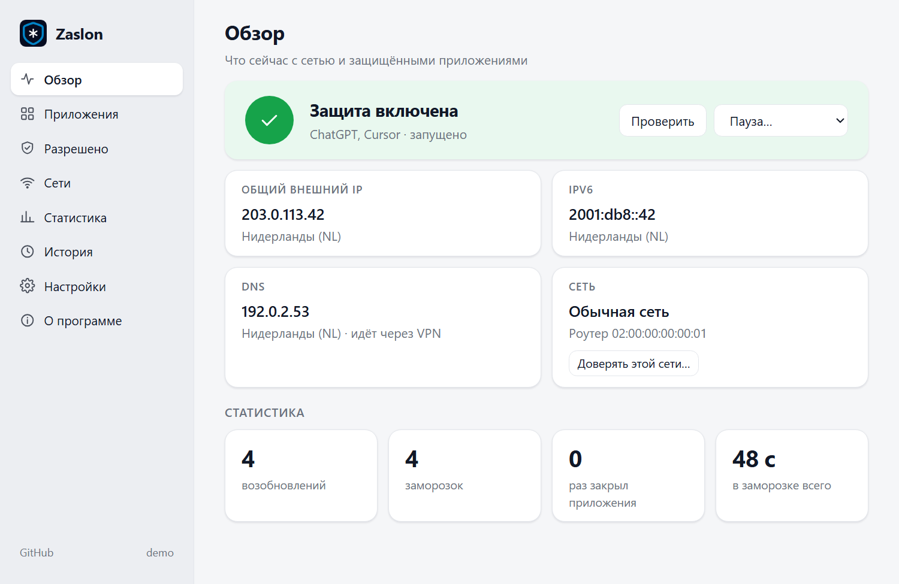
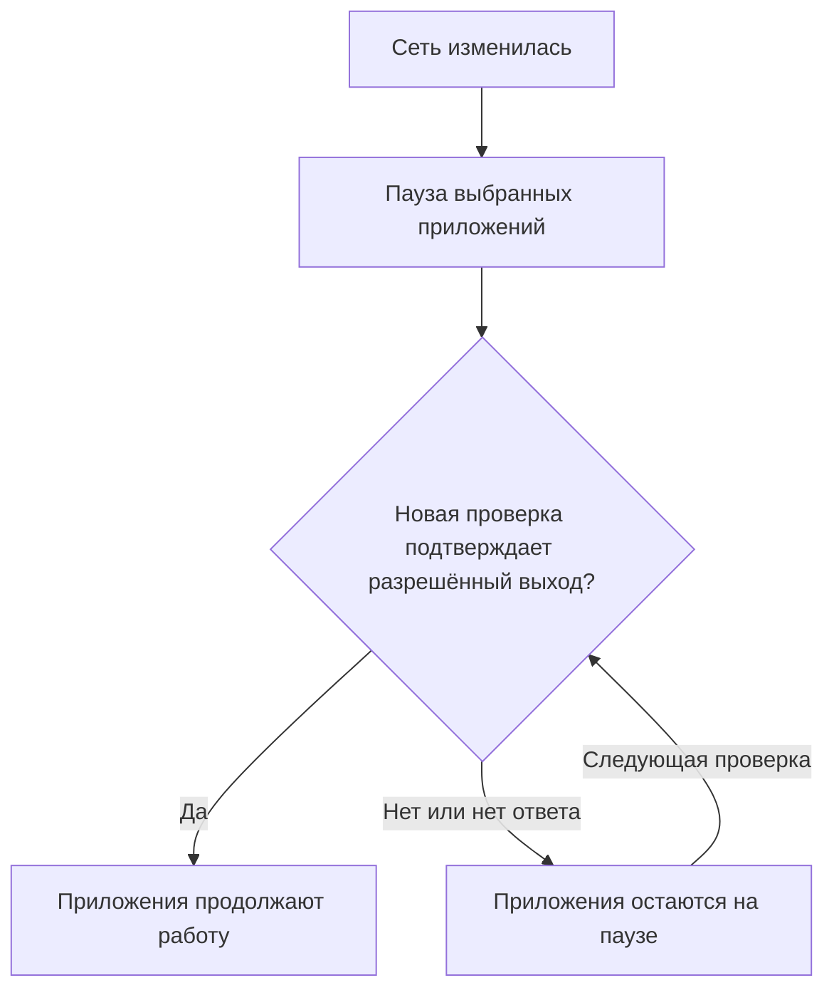

# Zaslon

Если VPN отключится и проверка покажет IP за пределами вашего списка, Zaslon поставит выбранные приложения на паузу. Как только разрешённый IP подтвердится, они продолжат работу. Можно защитить, например, ChatGPT и Cursor, а браузером пользоваться как обычно.

[English](README.en.md) · [Скачать Zaslon](https://github.com/avazar/zaslon/releases)



## Как это работает

Вы указываете, какие приложения защищать и какие IP, подсети или страны им разрешены. При смене сети Zaslon сначала ставит эти приложения и обнаруженные дочерние процессы на паузу. Чтобы снять паузу, он заново проверяет внешний IP.



Так работает строгий режим по умолчанию. Пока сеть стабильна, Zaslon проверяет IP в фоне. Если у приложения свой маршрут через VPN, можно включить проверку его доменов. Она выполняется, только пока приложение запущено. При тайм-ауте Zaslon сразу повторяет запрос к проблемному домену.

## С чего начать

### Установка на Windows

Распакуйте ZIP для Windows и запустите `zaslon.exe`. [Скачать архив](https://github.com/avazar/zaslon/releases)

Если нужен ярлык в меню «Пуск», воспользуйтесь установщиком PowerShell.

```powershell
irm https://raw.githubusercontent.com/avazar/zaslon/dev/install.ps1 | iex
```

### Установка на Linux и macOS

Запустите в терминале от своего пользователя, без `sudo`.

```sh
curl -fsSL https://raw.githubusercontent.com/avazar/zaslon/dev/install.sh | sh
```

### Первая настройка

1. Подключитесь к нужному VPN. В разделе **«Разрешено»** добавьте известный вам IP, подсеть или страну выхода. Если у VPN постоянный IP, одно разрешение на этот адрес точнее, чем разрешение на целую страну.
2. В разделе **«Приложения»** включите нужные программы. В новом профиле список выбранных приложений пуст. Для каждой программы можно задать свои разрешения.
3. Откройте выбранное приложение и загляните в **«Обзор»**. Там видны результат проверки и приложения, которые работают или стоят на паузе. Окно панели можно закрыть — защита продолжит работать.

## Удаление

Если вы распаковали ZIP на Windows вручную, отключите в настройках **«Запускать при входе в систему»**, выберите **«Выйти (защита выключится)»** в меню значка Zaslon и удалите распакованные файлы программы.

Если вы использовали установщик, выйдите из Zaslon через меню значка и выполните команду для своей системы. Установщик сохранит настройки и резервные копии.

**Windows (PowerShell)**

```powershell
irm https://raw.githubusercontent.com/avazar/zaslon/dev/uninstall.ps1 | iex
```

**Linux и macOS (терминал)**

```sh
curl -fsSL https://raw.githubusercontent.com/avazar/zaslon/dev/install.sh | sh -s -- uninstall
```

## Что важно знать

- **Пауза не блокирует пакеты.** Данные, которые приложение успело передать системе, всё ещё могут уйти. Для блокировки трафика на уровне сети нужны правила брандмауэра или сетевой kill switch вашего VPN.
- **Проверка видит соединение самого Zaslon.** Если приложение использует собственный прокси, его IP может отличаться даже при проверке того же домена. Совпадение страны само по себе не доказывает, что VPN работает.
- **Сбой сервиса проверки тоже может вызвать паузу.** По умолчанию Zaslon ждёт подтверждения. В настройках можно разрешить работу с предупреждением при недоступной проверке. Запрещённый IP по-прежнему вызывает паузу. При долгой паузе запрос внутри приложения может прерваться.
- **Zaslon пока доступен в предварительной версии.** Обрыв VPN и повторное подключение проверялись на Windows. Для Linux и macOS сценарии с реальными сбоями сети и графическим интерфейсом ещё требуют проверки.

Учётная запись не нужна. Настройки и история хранятся на компьютере. При проверке внешние сервисы видят IP, с которого к ним обращается Zaslon.

[Подробно о проверках сети](docs/NETWORK-CHECKS.md) · [Руководство для Windows](docs/WINDOWS-PACKAGE.txt) · [Руководство для Linux и macOS](docs/UNIX-PACKAGE.txt) · [Сообщить о проблеме](https://github.com/avazar/zaslon/issues)

Zaslon основан на [Kordon v1.2.1](https://github.com/ef1m03/kordon/tree/v1.2.1) и распространяется по [лицензии MIT](LICENSE).
